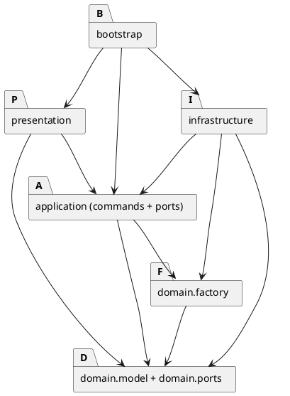

# Lab1 Phase 1 项目文档

本项目实现 TypeScript 面向对象的 CLI SVG 编辑器。当前完成领域模型及基础 CLI（init/create/tree/show/help），文件 IO 和撤销重做尚未接入。所有工程产物位于 EIE50009_lab1 内，需求和验收矩阵见 [requirements.md](requirements.md)。

## 架构方案

### 模块职责与目录

下列为总体目录规划，按实现阶段创建；当前已实现 domain/model、domain/ports 和 tests/domain。每个类独占同名 .ts 文件；接口也单独放置，入口仅负责装配。

| 目录 | 主要类/接口 | 职责 |
|---|---|---|
| src/domain/model | SvgDocument、Shape、ContainerShape、Group、Canvas、Rectangle、Circle、Ellipse、Line、TextShape、Style、DocumentMemento | 封装几何、样式、有序树、唯一 ID 和结构不变量；多态行为和内存快照 |
| src/domain/factory | ShapeFactory、ShapeDefinition 及六个具体 Definition | 唯一图形类型映射；CLI 参数和 SVG 属性均经同一类型定义构建对象 |
| src/domain/ports | ShapeSink | 类型无关的输出接口，接收元素名、属性、文本和开始/结束事件 |
| src/application | EditorSession、CommandDispatcher、History、HistoryEntry | 当前文档/读入路径、命令编排、事务和历史管理 |
| src/application/commands | Command、EditCommand、CreateCommand、MoveCommand 等各命令类 | 各命令参数校验、调用领域行为、生成成功摘要；查询、文档命令各自成类 |
| src/application/ports | DocumentStore、DocumentCodec | 文件读取/写入与文档编解码抽象，便于替换和故障测试 |
| src/presentation | CommandLineParser、TreeRenderer、ShowRenderer、ErrorFormatter | 词法解析、树/属性输出和统一错误显示，不修改模型 |
| src/infrastructure | NodeDocumentStore、SvgCodec、XmlShapeSink | Node 文件 IO 与 XML 解析/输出，落实应用层端口；不实现图形运算 |
| src/bootstrap | Main | 构建并注入具体依赖、接入标准输入输出，提供 npm run cli |
| tests | domain、application、integration 分组 | 不变量、事务/历史、命令回放和文件往返测试 |
| examples | 后续会话脚本及 SVG | 保存可回放案例及浏览器预览成果 |
| doc | README.md、requirements.md、architecture.puml | 架构、过程与验收证据 |

### 依赖方向

箭头表示源码依赖，不表示运行时数据流。图的独立源文件为 [architecture.puml](architecture.puml)。

- domain.model/ports 仅依赖语言标准能力和同层对象，不引用 application、Node、CLI、XML 库或 factory。
- domain.factory 依赖 domain.model/ports，负责构造，不执行 IO。模型 clone 必须走多态，不能倒向 factory。
- application 依赖 domain 和自身 ports；不能导入 infrastructure、presentation 或 Node 文件 API。CommandDispatcher 接收已解析 token，返回结果，不能调用 REPL。
- presentation 可依赖 application 的调用接口和 domain 的只读行为，不直接写模型；ErrorFormatter 负责添加 error:，领域错误不打印。
- infrastructure 实现 application ports，可依赖 domain/factory；XML 外部库只能出现在此层，不向内泄漏 DOM 节点。
- bootstrap 可依赖上述模块完成依赖注入，不承载编辑算法。测试可依赖被测模块。
- 禁止循环依赖和反向引用。实现阶段用 import 抽查/静态检查验证；违反规则需修复或记录架构修订，不能仅修改图掩盖问题。

### 封装与 Composite 落地

Shape 是抽象类，封装不可改名的 ID 和 Style，定义 move、scale、setAttribute、clone、emit、describe 等多态行为。具体图形自行校验和更新私有几何字段。公共样式校验复用 Style；类型特有属性由具体类负责，不由外部 switch(tag) 决定。

ContainerShape 维护私有有序子列表；Group 和内部 Canvas 是容器，Canvas 不作为可寻址图形。Group 的 move/scale 递归调用子节点同名方法，叶子处理自身坐标；不生成额外 transform。Group.setAttribute 只设置自身样式，子孙显式样式不被覆盖。几何缩放不缩放描边或字号。

SvgDocument 作为树的所有者，维护私有 ID 索引和父级索引，对外暴露按 ID 的编辑方法；结构修改集中由它协调，防止循环、重复 ID 和一节点多父级。节点集合只能返回只读投影或副本，不能暴露可变数组/Map/Style；查询输出不可泄漏可变节点供 CLI 操作。无需在 Shape 上暴露可写 parent 字段，父级信息由文档索引给出。

删除不应让叶子自己操作历史或全局索引：DeleteCommand 调用文档按 ID 删除子树，对叶子/容器使用同一入口；所有结构编辑也统一通过文档。这样满足 Composite 操作语义，同时保留树不变量的唯一维护者。

### Command、工厂与两处分派

Command 定义执行入口，具体命令封装参数和行为。EditCommand 定义对候选文档的 apply；CreateCommand、DeleteCommand、MoveCommand、ScaleCommand、SetCommand、GroupCommand、UngroupCommand、AddToCommand、FrontCommand、BackCommand 分别落地。文档类 Init/Read/Save/Canvas 和查询 Tree/Show/Help 也分别成类。CanvasCommand 根据参数区分查询和尺寸修改；UndoCommand/RedoCommand 调用 History。

CommandDispatcher 是唯一命令名到具体命令构造器的映射，既用于分发也提供 help 元信息。ShapeFactory 是唯一图形类型名到 ShapeDefinition 的映射；各 Definition 同时提供 create 参数构建和 SVG 属性构建能力，返回有行为的 Shape。SvgCodec 对每个图形元素调用此工厂，不再建立 XML 标签分派表。处理 svg 文档根是文件结构校验，不是第三套图形类型工厂。

Shape.emit(ShapeSink) 以多态输出类型、属性、文本和子树；XmlShapeSink 只负责通用 XML 转义与标签书写。describe 返回只读的属性展示值，TreeRenderer 按结构绘制树枝，不根据类型名分支。clone 由每种图形多态实现，避免快照恢复另造标签 switch。纯传输 token、结果、属性视图可以是 readonly 值；它们不替代有行为的领域对象。

**待重构项 R01/R02：**按作业要求，将 CommandDispatcher 命令映射和 ShapeFactory 类型映射标记为后续注册机制的重构点。本阶段采用封闭映射，不实现插件扫描、动态加载、ShapeProvider、box 或注册平台。属性白名单检查是属性校验，不是图形类型分派。

### 撤销重做方案比较与选择

| 方案 | 优点 | 代价/风险 | 结论 |
|---|---|---|---|
| 命令保存逆操作和最小差量 | 单条历史通常较小 | group/delete 必须保存多处父级和顺序；反向 scale 会累积浮点误差；失败回滚复杂 | 适合后续大文档优化 |
| Command + 完整 Memento | 精确恢复值、结构和顺序；统一失败隔离；redo 不重复 IO | 每次编辑复制整棵树，时间和空间 O(N)，H 条历史约 O(HN) | 本阶段采用 |
| 不可变树/结构共享 | 可降低复制成本 | 增加持久化数据结构与对象封装复杂度，不符合当前任务规模 | 暂不采用 |

选择 Command + Memento，不能只用快照替代命令对象。DocumentMemento 私有持有克隆树及画布信息，不对外暴露内部引用；恢复时产生独立领域对象，重新建立 ID/父级索引。HistoryEntry 封装命令说明和前后快照。History 私有维护 undo/redo 栈及屏障。

编辑事务顺序：

1. 解析并完成基本校验，复制当前文档为候选文档。
2. EditCommand 在候选文档执行；即使递归移动到一半溢出也只污染候选副本。
3. 验证整树不变量，准备前后 Memento、成功摘要和下一历史状态。
4. 在不再含 IO 或业务校验的提交段同步发布候选文档与历史状态，清空 redo、解除屏障，再输出摘要。
5. 任一步准备失败则丢弃候选，不动当前文档、索引、路径和历史。命令不能缓存长期有效的节点引用，只保存 ID/参数。

undo/redo 先准备从快照恢复的新文档和更新后的栈，再一起发布；不执行逆算术，也不重新 apply 命令。成功的无效果编辑仍建历史单元。查询、空行、注释和失败不改变栈。每条输入串行完成，包括异步文件 IO，避免 read/save 与后续编辑交错。

成功 init/read/save/canvas 修改均清空两栈并建立屏障；undo/redo 在屏障下统一报规定错误，下一成功编辑重新建立历史。canvas 查询不建立屏障。

read 在候选中完成 XML 校验、全量显式 ID 扫描、缺 ID 分配及建树；成功发布后才显示警告。save 先序列化，再由 DocumentStore 使用目标同目录临时文件和替换策略写入，失败不变更会话历史；不通过先删原文件再写的方式冒险。文件替换的实际平台行为须在实现阶段验证，临时文件失败清理亦须测试。默认路径仅由成功 read 设定，init 清除，另存不改。

## 已确认的语义

用户于 2026-10-29 明确同意上一轮建议。以下为项目决策，不冒充作业原文；完整背景见 requirements.md 的 D01—D15。

| 编号 | 确认规则 |
|---|---|
| D01 | group 至少两个不同目标，拒绝祖先后代同选；同父级在最早选中位置插入，跨父级在最近公共祖先的最早相关分支前插入，子项按操作前深度优先顺序。允许与未选节点的遮挡关系改变。 |
| D02 | 成功文档操作清空历史并设置屏障；下一成功编辑解除，不能回到屏障前。 |
| D03 | 仅保证六类型和受支持属性往返；不支持的 transform、单位、非匹配 viewBox、未知元素/属性明确拒绝。不实现背景 transform 示例、font-size/text-anchor 导入扩展。这是已接受的范围限制。 |
| D04 | g 的 set 修改自身公共样式，以 SVG 继承生效，不强制覆盖子孙。 |
| D05 | 无文档时允许 help、init、read，其余命令要求已有文档。 |
| D06 | 默认保存路径始终为最近成功 read 的路径，另存不重新绑定；init 后无默认路径，必须显式保存。 |
| D07 | front 放在同级列表末尾，back 放在开头，对应视觉最上/最下层。 |
| D08 | 先扫描显式 ID 并拒绝重复，再按文档顺序分配最小可用标签序号；成功后打印警告；svg 根不参加图形寻址。 |
| D09 | init 支持 0/1/2 参数，单参数高为 600；canvas 为 0 或 2 参数；有限数值，画布尺寸正数，几何尺寸/描边宽非负，位置可负，溢出失败。 |
| D10 | 空行及去除前导空白后的整行注释忽略；无行内注释；双引号支持路径、空文本及引号/反斜杠转义，普通路径反斜杠保留；未闭合引号失败。 |
| D11 | addto 禁止自身/后代循环，同父级移到末尾；成功无效果编辑也进入历史。 |
| D12 | 递归修改叶子几何，scale 基于全局原点，不修改 stroke-width 或字号，不叠加 transform。 |
| D13 | 先语法再文档/目标再操作校验；屏障错误先于空栈，空栈报 error: nothing to undo/redo；固定错误遵循原文，显示对齐不要求逐空格一致。 |
| D14 | 输出标准 SVG namespace、尺寸和匹配 viewBox；元素计数含 g/叶子、不含 svg；规范化负零、保留可往返数字及中文、正确 XML 转义。 |
| D15 | EOF 正常退出，支持标准输入回放和 npm run cli，不扩展 exit。 |

D03 的具体设计边界：根支持 xmlns、width、height 及可选 viewBox（若存在须等于 0 0 width height）；图形支持 id、公共样式及自身几何属性，text 的内容作为文本节点。XML 声明、注释、排版空白可接受；不支持 DTD、嵌套 svg、混合 text 子元素及其他元素/属性。未指定样式保持缺省；缺省几何按相应 SVG 零值处理，根尺寸要求显式正数。读取不受支持的结构应明确给出原因，不能静默略过。此段为本轮架构细化，后续若需扩展须同步验收范围。

D01 示例：根为 A[a,x]、B[b,y]，group G b a 后为 G[a,b]、A[x]、B[y]；撤销精确恢复原树。不因输入参数逆序改变 a/b 顺序。

## 变化点假设

| 可能变化 | 当前安排 | 刻意不做 |
|---|---|---|
| 新命令 | 独立 Command 类，在唯一命令映射装配 | 不建立动态命令插件系统 |
| 新图形类型 | Shape 多态和统一 ShapeDefinition；输出/clone 无类型分支 | 不实现 box、插件加载和插件内部子树保护 |
| 新交互入口 | application 不依赖 REPL，命令可被其他入口调用 | 不实现 GUI、网络或 agent API |
| SVG 支持扩大 | SvgCodec 与领域分离，可扩展导入策略并修订校验 | 不保留无法解释的原始 XML 来假装完整支持 |
| 文件存储变化 | DocumentStore 接口与 Node 实现分离 | 不引入云存储或数据库 |
| 大文档历史性能 | History/HistoryEntry 封装快照策略，后续可换差量或结构共享 | 当前不限制/截断历史，不先实现复杂增量算法 |
| 显示风格/错误格式 | presentation 集中处理，领域不打印 | 不做主题和国际化框架 |

## 过程记录

### 2026-10-29：需求分析

检查发现只有已初始化 Git，没有代码或提交。整理明确要求与 15 项建议、23 项验收项，记录 box/插件不在范围内。没有执行功能测试，也没有虚构纠错对话。

### 2026-10-29：语义确认与架构设计

用户接受上一轮建议并要求设计架构、检查后提交。沿用现有 Git，选定 Command + Memento 和候选文档事务；比较逆操作与结构共享后，以精确恢复及原子性优先。识别 XML 导入、序列化和快照克隆容易出现额外类型分派，分别用统一工厂、多态 emit 和 clone 规避。记录 D03 的受限导入范围及其不能覆盖背景示例的影响。新增独立 PlantUML 源文件，并将需求清单的建议状态更新为已确认。

## 一致性自查

- 设计层：模块图与依赖规则对应，无反向依赖；Command 和 Composite 有具体职责；两处分派有明确位置和待重构编号；文件 IO 与领域行为隔离。
- 实现层：领域模型和领域测试已落地，其余模块仍为规划；当前领域依赖、封装和多态检查通过，完整功能测试尚未完成。
- 后续每轮核对实际类文件名、私有字段、导入关系、类型分派位置；任何设计调整在本节记录，并同步图和正文。

## 质量保证手段

本轮校对文档链接、PlantUML 源与内嵌图一致性及 Git 差异空白检查；未安装 PlantUML 渲染器，未声称完成图形渲染验证。领域模型测试结果见下方阶段记录；完整命令验收详见 requirements.md A01—A23，尚未完成。

后续重点：各命令及类型参数矩阵；失败时完整会话不变；结构编辑撤销后父级和顺序精确恢复；浮点移动/缩放撤销不漂移；文档屏障；SVG 语义往返和浏览器预览；第 6 节及第 6.1 节版本 A 回放；TypeScript 编译及依赖/封装审查。提交按需求/架构、模型、命令、历史、文件 IO、验收逐步推进，最终才建立 final 标签。截止日期尚未提供。

### 2026-10-29：领域模型实现与验证

沿用架构，建立 TypeScript 严格编译和 Node 内置测试工程。实现 Shape/ContainerShape 层次、六种内置图形、Canvas、SvgDocument、Style、Numbers、DocumentMemento，以及只读 ShapeView 和 ShapeSink 输出端口。所有类独占同名文件，字段使用 ECMAScript 私有字段；没有图形 tag 分派。

统一操作证据：同一 Shape 数组对六种类型执行 move、scale、setAttribute、clone；嵌套 Group 递归移动/缩放后仍可按 ID 编辑内部叶子。几何校验和变换在具体图形内，树所有权/索引在 SvgDocument 内；命令层不会承担图形算法。

自查补强：容器原有防环检查之外增加私有 WeakMap 所有权约束，拒绝同一对象挂到两个父级。输入节点进入文档时克隆，查询返回冻结投影，内部 visitOwned/insertOwned/removeOwned 只用于领域协作，应用层不能获得文档内部节点。结构变更后重新建立父级与 ID 索引，避免容器替换子节点后索引指向旧对象。

本阶段 SvgDocument 的修改方法采用候选副本，失败直接丢弃；ContainerShape 对递归变换也采用候选子树，保证直接操作容器时发生溢出仍保持原状态。这使深层嵌套变换存在重复复制，最坏可能达到 O(N×深度)，并非所有操作都只有 O(N)。当前优先保证正确性，后续应用事务可基于实测优化复制，不提前引入复杂持久化树。

验证结果：npm test 完成 TypeScript 编译及 11 项领域测试，全部通过。覆盖画布尺寸、六类型多态、嵌套容器、大小写 ID/子树重复 ID、移动归属和索引、循环/多父级、删除释放 ID、失败溢出原子性、样式继承、快照独立性、只读查询和多态输出事件。ShapeSink 测试仅验证事件，不代表 SVG 文件 IO 已完成。

目录一致性：本阶段建立 src/domain/model、src/domain/ports 和 tests/domain，均在规划目录内；factory/application/presentation/infrastructure/bootstrap 按阶段尚未创建。提前实现领域级 addTo/delete 和内存 Memento，用于验证父子关系、ID 释放及克隆隔离，不代表 CLI addto/delete 或 undo/redo 命令完成。依赖仅在 domain 内，外部 IO 未进入领域。

验收进度：A05/A06/A07/A10/A14/A20/A21 获得部分领域级证据，相关 CLI/历史/完整功能验收仍待后续执行；不将整个 Phase 1 标记为通过。

### 2026-10-29：CLI 基础命令阶段

实现 CommandLineParser、Repl、EditorSession、CommandDispatcher 以及独立 Init/Create/Tree/Show/Help 命令类，Main 装配 readline 标准输入输出。ShapeFactory 是唯一图形类型分派，六个 Definition 分别校验参数并构造模型。没有将几何业务搬入命令分发器或 REPL。

新增 DocumentDisplay 应用端口，由 presentation 的 TextDocumentDisplay、TreeRenderer、ShowRenderer 实现；命令通过接口获取文本展示，避免 application 反向依赖 presentation。ShapeFormatter 仅遍历领域只读属性，不按图形标签分派。展示采用完整几何属性名（width/height 等），保留原文要求的树层级、关键几何和父级信息，不逐字符仿制示例排版。

解析器保留 token 是否加引号的信息，只有未加引号的尾部 in 才识别为归属子句，文本 "in" 和空文本可正常创建。颜色 #ffffff 不当作注释，支持浮点、中文、双引号与反斜杠转义。错误由 ErrorFormatter 统一添加单行 error: 前缀；失败不替换当前文档。help 可在 init 前执行，并列出当前已实现命令与六种创建参数，明确后续命令尚未实现。

验证：npm test 编译并通过全部 16 项测试（原 11 项领域测试及 5 项集成测试）；npm run check 通过。集成测试覆盖 token 边界、六类型构建、嵌套 in、show/tree、默认尺寸、未知命令/类型、重复 ID、无容器/非容器、错误参数、失败后完整树与画布保持不变，以及真实 Node 子进程 EOF 退出。另用 examples/intro.txt 实际执行 npm run cli，验证中文、颜色、错误恢复和嵌套结构。

架构进度：factory、application、presentation、bootstrap 按规划落地；新增应用接口 CommandToken 和 DocumentDisplay，均为只读传输/抽象，不是贫血领域模型。ShapeDefinition 当前仅实现 CLI 构造；SVG 属性构造留在 read 阶段扩展同一工厂，不新增类型分派。Command 已开始落地；EditCommand 和 History 仍待撤销阶段实现，不宣称 create 已支持撤销。A01/A03/A04/A15 的本轮支持范围已有集成证据，完整 help/历史/IO 验收待后续补齐。
